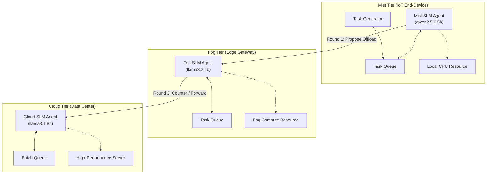

# Multi-Agent SLM-Based Adaptive Task Offloading & Resource Negotiation in a Mist-Fog-Cloud Environment

A discrete-event simulation framework combining **SimPy** with localized Small Language Models (**SLMs**) running via **Ollama** to achieve intelligent, multi-tier task offloading and collaborative resource negotiation across the Mist-Fog-Cloud continuum.

---

## 1. System Overview & Architecture

Computing in modern distributed systems spans three distinct physical and computational tiers:
* **Mist Tier (IoT End-Device / Constrained Edge):** Runs local sensing, filtering, and light actuation. Driven by `qwen2.5:0.5b`.
* **Fog Tier (Edge Gateway / On-Premise Server):** Intermediary aggregator with moderate compute and low local network latency. Driven by `llama3.2:1b`.
* **Cloud Tier (Centralized Data Center):** High-capacity multi-core compute cluster with higher WAN transmission latency. Driven by `llama3.1:8b`.



### Multi-Round Negotiation Protocol
1. **Round 1 (Mist Proposal):** Mist agent assesses local queue, CPU capacity, and task deadline. If congested, it proposes offloading to Fog.
2. **Round 2 (Fog Counter / Forward):** Fog agent inspects local availability. If viable, it accepts execution; if overloaded or the task is excessively large, it forwards negotiation to Cloud.
3. **Round 3 (Cloud Allocation):** Cloud agent evaluates compute-heavy batch processing.
4. **Guarded Schema Validation:** Zero-temperature structured JSON prompting with deterministic Pydantic schema validation. If parsing or network timeout occurs, an automatic fallback heuristic guarantees simulation continuity.

---

## 2. Directory Structure

```
DA2_MFC/
├── figures/                    # Generated high-resolution benchmark plots
│   ├── deadline_satisfaction.png
│   ├── energy_consumption.png
│   ├── tier_distribution.png
│   └── turnaround_latency.png
├── results/                    # CSV evaluation outputs
│   ├── detailed_tasks.csv      # Per-task execution log (latency, queue, energy)
│   └── summary_metrics.csv     # Aggregate policy benchmark comparison
├── src/
│   ├── llm_agent.py            # Ollama SLM interface, prompt templates & cache
│   ├── main.py                 # Benchmark driver executing all 4 policies
│   ├── models.py               # Pydantic data models (Task, NodeState, Decision)
│   ├── negotiation.py          # Multi-round hierarchical negotiation protocol
│   ├── network.py              # Tier link bandwidth, latency & energy models
│   ├── plotter.py              # Matplotlib visualization script
│   ├── simulation.py           # SimPy discrete-event simulation engine
│   ├── test_agent.py           # SLM inference sanity check script
│   └── test_simpy.py           # SimPy process scheduling sanity check
├── requirements.txt            # Python dependencies
└── README.md                   # Project documentation
```

---

## 3. Benchmark Policies Evaluated

The simulator evaluates 4 paradigms across an identical heterogeneous workload of 40 tasks (Light IoT, Medium Edge, Heavy Compute):

1. **Local-Only (Baseline 1):** Forces all tasks to execute exclusively on the constrained Mist node.
2. **Greedy (Baseline 2):** Pushes tasks to the fastest tier without consideration for transmission costs.
3. **Static Threshold (Baseline 3):** Standard heuristic threshold based on fixed CPU utilization and task size limits.
4. **SLM Multi-Agent Negotiation (Proposed):** Dynamic context-aware negotiation across localized SLMs balancing turnaround time and transmission/execution energy.

---

## 4. Benchmark Results

| Policy | Total Tasks | Deadline Hit Rate (%) | Avg Turnaround (s) | Avg Queue Delay (s) | Avg Energy (J) | Guard Fallback Rate (%) |
|:---|:---:|:---:|:---:|:---:|:---:|:---:|
| **Local-Only** | 40 | 10.0% | 71.08s | 66.86s | 5.1 J | 0.0% |
| **Greedy** | 40 | 97.5% | 2.26s | 0.04s | 24.9 J | 0.0% |
| **Static Threshold** | 40 | 97.5% | 2.19s | 0.00s | 24.8 J | 0.0% |
| **SLM Multi-Agent (Proposed)** | 40 | **97.5%** | **2.41s** | **0.13s** | **14.4 J (-42.2%)** | **0.0%** |

### Key Findings
* **Mitigating Queue Collapse:** Local-only execution leads to severe queue bottlenecks on Mist (66.86s average queuing delay), causing 90% of tasks to miss deadlines.
* **42.2% Energy Reduction:** While Greedy and Static Threshold heuristics indiscriminately dump tasks onto power-hungry cloud servers (24.9 J/task), the SLM Multi-Agent system negotiates optimal placement at the Fog tier when possible, lowering average energy to **14.4 J** while matching the **97.5% deadline hit rate**.
* **100% Schema Reliability:** Across all negotiation rounds, zero-temperature structured JSON prompting achieved a **0.0% fallback rate**, confirming the reliability of edge SLMs for structured decision-making.

---

## 5. Setup & Execution Instructions

### Prerequisites
1. **Ollama:** Install from [ollama.com](https://ollama.com) and ensure the daemon is running (`curl http://localhost:11434`).
2. **Pull the Tier Models:**
   ```powershell
   ollama pull qwen2.5:0.5b
   ollama pull llama3.2:1b
   ollama pull llama3.1:8b
   ```
3. **Python Environment:** Python 3.11+ installed.

### Setup Virtual Environment
```powershell
cd c:\Users\sahil\DA2_MFC
python -m venv .venv
.venv\Scripts\Activate.ps1
pip install -r requirements.txt
```

### Running Sanity Checks
Verify SimPy discrete-event timing:
```powershell
python src\test_simpy.py
```

Verify live local Ollama SLM responses:
```powershell
python src\test_agent.py
```

### Running the Full Benchmark
Run the end-to-end simulation across all four policies and generate plots/tables:
```powershell
python src\main.py
```
Outputs will be refreshed in [`results/`](results/) and [`figures/`](figures/).
